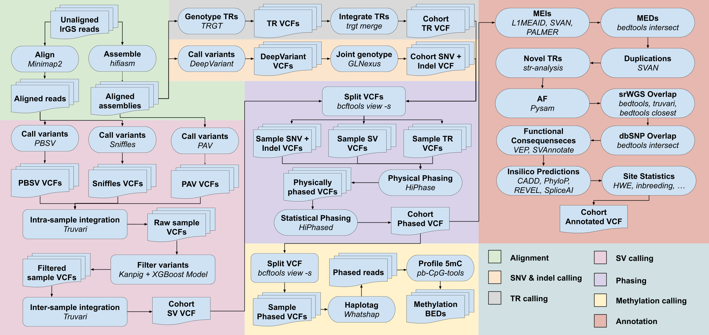

# Pipeline
This document describes how to run the pipeline end-to-end on a new cohort, starting from raw unaligned lrGS reads and finishing with an annotated cohort VCF. It is organized into three steps: generating the cohort callsets, phasing them, and annotating them. Depth-based CNV calling is a separate path, covered in [CNV Pipeline](pipeline_cnvs.md).

Each workflow below is run on its own and passes its outputs to the next as inputs; on Terra, outputs are written to the data table and the next workflow's inputs point at those columns. Numbered lists are sequential; bulleted lists run in parallel. [Run Order](#run-order) flattens the whole pipeline into numbered steps, where every workflow sharing a number can run at the same time. For the specific sequence of steps used to build the existing HPRC/HGSVC and All of Us callsets, including the ad-hoc reruns and one-off fixes those callsets required, see [Trace](trace.md).

The overview is a schematic of the stages. Where it names a tool that differs from the text below - haplotagging is now done by HiPhase rather than Whatshap, for instance - the text is current.

## Inputs
Everything below is cohort-specific and must be supplied per run. Reference files, repeat catalogs and Docker images are shared across cohorts and supplied separately - see [References](references.md) and [Docker images](dockers.md).
- **Unaligned lrGS reads** - one unaligned BAM per sample, plus the sample IDs.
- **PED** - six-column pedigree covering every sample, providing each sample's sex (`1` male, `2` female). Every sample is treated as unrelated, so the family and parent columns are not used. Required by the coverage, post-processing and allele frequency steps.
- **Ancestry** - per-sample genetic similarity group assignments, used for allele frequency annotation.
- **Cohort metadata TSV** - PED and ancestry combined into the single table the TR histograms consume. [CreateCohortMetadata](../wdl/annotation_utils/CreateCohortMetadata.wdl) builds it if you only have the two files separately.
- **Phased truth base VCFs** _(optional)_ - haplotype-resolved VCFs covering the cohort's samples. Supplying these enables backbone phasing in step 2.
- **Sample age data** _(optional)_ - per-sample ages. Supplying this enables age-bin carrier annotation in step 3.

## Run Order
Every workflow below, in dependency order. Workflows that share a step number need nothing from each other, so they can all be launched once the previous step finishes. On Terra the method configs are prefixed with these numbers. Per-sample workflows run once for each sample, and per-cohort workflows run once over the whole cohort. Optional workflows (backbone phasing, age metrics and the [Optional Analyses](#optional-analyses)) are left out.

| Step | Per sample | Per cohort |
| --- | --- | --- |
| 01 | MinimapReadAlignment, Hifiasm | CreateCohortMetadata |
| 02 | DeepVariant, PBSV, Sniffles, TRGT (once per catalog), MosDepth, PALMERDiploid, MinimapAlignment, PAV | - |
| 03 | CombineTRs, ConcatenateMosDepth, PALMERAssembly | GLNexus, MergeSampleSVCallsets |
| 04 | AnnotateTREndTags | MergeCohortSVCallsets, MergeCohortLongSVCallsets, CreateCohortCoverageSummary, IdentifyLowCoverageRegions, MergePALMERCallsets |
| 05 | - | RegenotypeSVCallsets |
| 06 | - | MergeRegenotypedSVCallsets |
| 07 | - | PreprocessVcfs |
| 08 | ExtractSampleVcfs | - |
| 09 | HiPhase | - |
| 10 | MethylationProfiling | MergeHiPhaseCallsets |
| 11 | - | FillPhasedGenotypes, TRGTLPS, CreateCohortMethylationFile |
| 12 | - | IntegrateTRs, CreateTRGTHistograms |
| 13 | - | RepeatMasker, AnnotateL1MEAID, AnnotateSVAN, AnnotateMEDs, AnnotateIndelTRs, AnnotateRegion, AnnotateInSilicoPredictors, AnnotateGnomADSTR, AnnotateDbSNP, AnnotateVRS |
| 14 | - | AnnotatePALMER, SubsetTsvToColumns |
| 15 | - | AnnotateMEIs |
| 16 | - | AnnotateAlleleType |
| 17 | - | AnnotateVEPHail, AnnotateSVAnnotate, AnnotateCallsetOverlap, AnnotateDbVaR |
| 18 | - | AnnotateVcf |
| 19 | - | PostprocessCallset |
| 20 | - | ResolveHaplotypeOverlaps |
| 21 | - | FilterLowCoverageRegions |
| 22 | - | FilterLowCoverageGenotypes |
| 23 | - | AnnotateSQMetrics, AnnotateGQMetrics |
| 24 | - | AnnotateVcf |
| 25 | - | AnnotateAF |
| 26 | - | NormalizeAlleleTypes |
| 27 | - | FilterNCRCutoffs |
| 28 | - | StripGenotypes |

## 1. Preprocessing
Reads are aligned and assembled, three variant callsets (SNV/indel, SV and TR) are generated per sample and integrated across the cohort, and the depth and mobile element files that later steps depend on are built alongside them.

### Alignment and Assembly
Alignment and assembly are independent and run concurrently; only the assembly branch has a second step.
- **[MinimapReadAlignment](../wdl/tools/MinimapReadAlignment.wdl)** - align the raw reads to GRCh38 with Minimap2. Every read-based caller below runs on this BAM.
- Assembly branch:
  1. **[Hifiasm](../wdl/tools/Hifiasm.wdl)** - assemble the reads with hifiasm into two haplotype FASTAs. Without parental or Hi-C data the haplotype assignment is arbitrary rather than maternal and paternal, so the two are interchangeable downstream.
  2. **[MinimapAlignment](../wdl/tools/MinimapAlignment.wdl)** - align the two assembly haplotypes to GRCh38, producing the per-haplotype assembly BAMs that PALMER consumes.

### SNV/Indel Callset
1. **[DeepVariant](../wdl/tools/DeepVariant.wdl)** - call short variants per sample from the aligned reads, emitting a gVCF.
2. **[GLNexus](../wdl/tools/GLNexus.wdl)** - joint-genotype the per-sample gVCFs into a cohort SNV/indel VCF.

### SV Callset
Several callers are run per sample and merged within each sample, the per-sample calls are merged across the cohort, and every sample is then regenotyped at every cohort site with Kanpig. Calls are split by size during the per-sample merge: SVs of 20bp to 2kb go through scoring and regenotyping, while longer SVs and breakends are integrated separately.
1. Callers run in parallel:
   - **[PBSV](../wdl/tools/PBSV.wdl)** - read-based calls from the aligned reads.
   - **[Sniffles](../wdl/tools/Sniffles.wdl)** - read-based calls from the aligned reads.
   - **[PAV](../wdl/tools/PAV.wdl)** - assembly-based calls, taking the hifiasm haplotype FASTAs directly rather than the `MinimapAlignment` BAMs.
2. **[MergeSampleSVCallsets](../wdl/tools/MergeSampleSVCallsets.wdl)** - per sample, normalize each caller's VCF and split it into SVs of 20bp to 2kb, longer SVs and breakends, then merge the callers within each class with `truvari collapse --intra`. The 20bp to 2kb SVs are then genotyped with Kanpig against the sample's reads, keeping only calls with ALT support, and scored with an XGBoost model trained on matches to a truth resource.
3. Cohort integration, in parallel:
   - **[MergeCohortSVCallsets](../wdl/tools/MergeCohortSVCallsets.wdl)** - merge the scored 20bp to 2kb SVs across the cohort with `bcftools merge`, then collapse matching sites with `truvari collapse`, into a cohort SV VCF.
   - **[MergeCohortLongSVCallsets](../wdl/tools/MergeCohortLongSVCallsets.wdl)** - merge and collapse the longer SVs and breakends across the cohort the same way, without scoring or regenotyping.
4. **[RegenotypeSVCallsets](../wdl/tools/RegenotypeSVCallsets.wdl)** - regenotype every sample at every site of the cohort SV VCF with Kanpig, against its reads.
5. **[MergeRegenotypedSVCallsets](../wdl/tools/MergeRegenotypedSVCallsets.wdl)** - merge every sample's regenotyped calls by variant ID, dropping sites no sample carries, and concatenate them into the regenotyped cohort SV VCF.

The SV callset is the regenotyped cohort SV VCF from step 5 together with the longer SV and breakend VCF from step 3.

### TRGT Callset
1. **[TRGT](../wdl/tools/TRGT.wdl)** - genotype tandem repeat loci per sample from the aligned reads, run once per catalog: TRExplorer v1.0.1 and Vamos v2.1.
2. **[CombineTRs](../wdl/annotation_utils/CombineTRs.wdl)** - deduplicate loci that overlap between the two catalogs into a single per-sample TR VCF.
3. **[AnnotateTREndTags](../wdl/annotation_utils/AnnotateTREndTags.wdl)** - add the `END` INFO field that `trgt merge` requires during phasing.

### Callset Integration
**[PreprocessVcfs](../wdl/annotation_utils/PreprocessVcfs.wdl)** - normalize, harmonize sample IDs, source-tag and length-filter the cohort SNV/indel and SV VCFs, add the core `allele_type` and `allele_length` INFO fields, rename variant IDs, and merge the two into one cohort integrated VCF. The TR VCFs are held back and merged in during phasing.

### Depth Summary
1. **[MosDepth](../wdl/tools/MosDepth.wdl)** - compute per-base coverage per sample, scattered per contig.
2. **[ConcatenateMosDepth](../wdl/annotation_utils/ConcatenateMosDepth.wdl)** - concatenate each sample's per-contig BEDs into one indexed per-base BED.
3. Cohort summaries, in parallel:
   - **[CreateCohortCoverageSummary](../wdl/annotation_utils/CreateCohortCoverageSummary.wdl)** - binned coverage across all samples, for the browser and QC.
   - **[IdentifyLowCoverageRegions](../wdl/annotation_utils/IdentifyLowCoverageRegions.wdl)** - flag recurrently low-coverage bins and derive per-sample coverage cutoffs; both feed the filtering steps in step 3.

The cohort binned-coverage matrix and ploidy estimates from `CreateCohortDepthFiles` are only needed for depth-based CNV calling, which the [CNV pipeline](pipeline_cnvs.md) covers.

### Mobile Element Calls
1. **[PALMERDiploid](../wdl/tools/PALMERDiploid.wdl)** and **[PALMERAssembly](../wdl/tools/PALMERAssembly.wdl)** - call mobile element insertions per sample from the reads and from the assembly BAMs respectively.
2. **[MergePALMERCallsets](../wdl/tools/MergePALMERCallsets.wdl)** - merge the per-sample calls into the cohort PALMER VCF that `AnnotatePALMER` consumes in step 3.

Step 1 ends with a cohort integrated VCF, per-sample TR VCFs, a cohort PALMER VCF, and the depth and coverage-cutoff files.

## 2. Phasing
The cohort integrated VCF is split back per sample and physically phased with HiPhase alongside the TR calls, then those phase blocks are linked into longer haplotypes by transferring phase from the truth base VCFs. TR histograms and methylation profiles are produced from the same outputs.

### Physical Phasing
1. **[ExtractSampleVcfs](../wdl/annotation_utils/ExtractSampleVcfs.wdl)** - extract each sample's SNV/indel and SV VCFs from the cohort integrated VCF. Runs once per sample.
2. **[HiPhase](../wdl/tools/HiPhase.wdl)** - jointly phase each sample's SNV/indel, SV and TR VCFs against its aligned reads. Set `run_haplotagging = true` so the haplotagged BAM is available for methylation. Run twice per sample, with and without the TR VCF; the no-TRGT run is needed to recover phase during backbone merging.
3. **[MergeHiPhaseCallsets](../wdl/tools/MergeHiPhaseCallsets.wdl)** - merge the per-sample phased VCFs across the cohort. TR calls are merged separately with `trgt merge`, so this yields both a cohort integrated phased VCF and a cohort TRGT VCF.
4. **[FillPhasedGenotypes](../wdl/annotation_utils/FillPhasedGenotypes.wdl)** - restore the `0/0` genotypes dropped by the per-sample split, pulling them from the pre-phasing cohort integrated VCF. Run on both the TRGT and no-TRGT merges.
5. **[IntegrateTRs](../wdl/annotation_utils/IntegrateTRs.wdl)** - combine the cohort TRGT VCF into the phased cohort VCF, flagging variants that overlap a TR locus.

### Backbone Phasing
Phase is transferred from the input truth base VCFs to link HiPhase phase blocks into longer haplotypes. This section only applies when truth base VCFs were supplied; without them, the `IntegrateTRs` output is the cohort phased VCF that step 3 takes. These workflows operate on one contig at a time, so the VCF is sharded and reassembled around them.
1. **[SplitVcfPerContig](../wdl/annotation_utils/SplitVcfPerContig.wdl)** - shard both phased cohort VCFs per contig: the `IntegrateTRs` output and the no-TRGT merge from `FillPhasedGenotypes`.
2. **[BackbonePhase](../wdl/tools/BackbonePhase.wdl)** - transfer phase from the truth base VCFs onto each shard, connecting phase blocks.
3. **[FillBackbonePhasedGenotypes](../wdl/annotation_utils/FillBackbonePhasedGenotypes.wdl)** - fill genotypes still unphased in the TRGT shard from the corresponding no-TRGT shard.
4. **[ConcatenateVcfsAcrossContigs](../wdl/annotation_utils/ConcatenateVcfsAcrossContigs.wdl)** - reassemble the shards into the cohort phased VCF, which is the input to step 3.
5. **[EvaluateBackbonePhasing](../wdl/annotation_utils/EvaluateBackbonePhasing.wdl)** - QC the transferred phase against the base VCFs.

### TR Histograms
1. **[TRGTLPS](../wdl/tools/TRGTLPS.wdl)** - compute the longest polymer sequence (LPS) per TR locus per sample from the cohort TRGT VCF, plus per-contig TRID metadata.
2. **[CreateTRGTHistograms](../wdl/annotation_utils/CreateTRGTHistograms.wdl)** - combine the LPS table, the TRID metadata and the cohort metadata into per-locus stratified histograms for the TR browser.

### Methylation
1. **[MethylationProfiling](../wdl/tools/MethylationProfiling.wdl)** - profile 5mC per sample with pb-CpG-tools from the HiPhase haplotagged BAM, emitting combined and per-haplotype CpG BEDs.
2. **[CreateCohortMethylationFile](../wdl/annotation_utils/CreateCohortMethylationFile.wdl)** - combine the per-sample BEDs into per-contig cohort methylation matrices.

Step 2 ends with the cohort phased VCF, the cohort TRGT VCF and its LPS table and histograms, and the cohort methylation files.

## 3. Annotation
Annotation has two halves. Characterization runs a suite of workflows that read a VCF and emit annotation TSVs without modifying it, so they parallelize freely; only `AnnotateAlleleType` rewrites the VCF mid-way, which is what splits characterization into stages. Integration then folds every TSV back into the VCF and filters it for release.

### Variant Characterization
The VCF advances only at stage 4. Stages 1 to 3 read the cohort phased VCF from step 2; stage 5 reads the allele-type-annotated VCF that stage 4 produces.
1. In parallel on the cohort phased VCF, as soon as step 2 finishes. Site and genotype quality metrics are not computed here; they run in Integration and Release once the genotypes are final:
   - **[RepeatMasker](../wdl/tools/RepeatMasker.wdl)** - extract insertion sequences from the cohort phased VCF and identify their repeat content, giving the repeat file `AnnotatePALMER` needs.
   - **[AnnotateL1MEAID](../wdl/annotation/AnnotateL1MEAID.wdl)** - identify MEIs with L1ME-AID, running its own RepeatMasker pass over the insertion sequences.
   - **[AnnotateSVAN](../wdl/annotation/AnnotateSVAN.wdl)** - identify MEIs, MEDs, tandem duplications, dispersed duplications and NUMTs with SVAN.
   - **[AnnotateMEDs](../wdl/annotation/AnnotateMEDs.wdl)** - identify mobile element deletions by intersecting deletions against the MEI catalog.
   - **[AnnotateIndelTRs](../wdl/annotation/AnnotateIndelTRs.wdl)** - flag short indels that represent tandem repeats.
   - **[AnnotateRegion](../wdl/annotation/AnnotateRegion.wdl)** - assign each variant a genomic region class (SR, SD, RM or US).
   - **[AnnotateInSilicoPredictors](../wdl/annotation/AnnotateInSilicoPredictors.wdl)** - look up CADD, Pangolin, PhyloP, REVEL and SpliceAI scores.
   - **[AnnotateGnomADSTR](../wdl/annotation/AnnotateGnomADSTR.wdl)** - match TR calls against the gnomAD V4 STR catalog.
   - **[AnnotateDbSNP](../wdl/annotation/AnnotateDbSNP.wdl)** - assign dbSNP rsIDs to matched SNVs and indels.
   - **[AnnotateVRS](../wdl/annotation/AnnotateVRS.wdl)** - annotate each variant with GA4GH VRS identifiers.
   - **[AnnotateAgeMetrics](../wdl/annotation/AnnotateAgeMetrics.wdl)** - age-bin carrier distributions per variant. Only run when sample age data was supplied.
2. In parallel on the cohort phased VCF, from the stage 1 outputs:
   - **[AnnotatePALMER](../wdl/annotation/AnnotatePALMER.wdl)** - match the cohort PALMER VCF from step 1 against the callset insertions, using the RepeatMasker output.
   - **[SubsetTsvToColumns](../wdl/annotation_utils/SubsetTsvToColumns.wdl)** - extract the duplications of interest from the SVAN output.
3. **[AnnotateMEIs](../wdl/annotation/AnnotateMEIs.wdl)** - compare the L1MEAID, PALMER and SVAN evidence and synthesize one harmonized MEI TSV.
4. **[AnnotateAlleleType](../wdl/annotation_utils/AnnotateAlleleType.wdl)** - rewrite the `allele_type` INFO field from the MED, MEI and duplication TSVs, and record each duplication's source coordinates in `ORIGIN`, producing the allele-type-annotated VCF.
5. Functional and overlap annotation, in parallel on the allele-type-annotated VCF. These run after stage 4 because their predictions depend on the final `allele_type`:
   - **[AnnotateVEPHail](../wdl/annotation/AnnotateVEPHail.wdl)** - predict functional effects with VEP via Hail.
   - **[AnnotateSVAnnotate](../wdl/annotation/AnnotateSVAnnotate.wdl)** - predict functional effects for SVs with GATK SVAnnotate.
   - **[AnnotateCallsetOverlap](../wdl/annotation/AnnotateCallsetOverlap.wdl)** - identify gnomAD V4 overlaps via exact, Truvari and bedtools closest matching.
   - **[AnnotateDbVaR](../wdl/annotation/AnnotateDbVaR.wdl)** - match SVs against dbVar records.

### Integration and Release
Each step takes the previous step's VCF, starting from the allele-type-annotated VCF.
1. **[AnnotateVcf](../wdl/annotation_utils/AnnotateVcf.wdl)** - write every annotation TSV produced by the characterization stages into the allele-type-annotated VCF as INFO fields.
2. **[PostprocessCallset](../wdl/annotation_utils/PostprocessCallset.wdl)** - normalize ploidy, recompute `AC` and `AN` from the resulting genotypes, prune MEIs, flag homopolymer TRs, drop working FILTER values and filter singletons, switched on by `run_normalize_ploidy`, `run_compute_allele_counts`, `run_prune_meis`, `run_flag_homopolymer_trvs`, `run_drop_filters`, `run_filter_assembly_only_singletons` and `run_filter_single_read_singletons`. The singleton filters read `AC`, which is why the counts are recomputed here rather than waiting for `AnnotateAF`.
3. **[ResolveHaplotypeOverlaps](../wdl/annotation_utils/ResolveHaplotypeOverlaps.wdl)** - resolve calls that overlap on the same haplotype.
4. **[FilterLowCoverageRegions](../wdl/annotation_utils/FilterLowCoverageRegions.wdl)** - filter variants falling in the recurrently low-coverage bins identified in step 1.
5. **[FilterLowCoverageGenotypes](../wdl/annotation_utils/FilterLowCoverageGenotypes.wdl)** - no-call genotypes falling below each sample's coverage cutoff from step 1.
6. Quality metrics on the final genotypes, in order. These run after steps 2, 3 and 5 because those change genotypes:
   1. In parallel:
      - **[AnnotateSQMetrics](../wdl/annotation/AnnotateSQMetrics.wdl)** - site-level quality metrics (HWE, inbreeding coefficient, AS fields).
      - **[AnnotateGQMetrics](../wdl/annotation/AnnotateGQMetrics.wdl)** - binned genotype quality and allele balance distributions.
   2. **[AnnotateVcf](../wdl/annotation_utils/AnnotateVcf.wdl)** - write the two metric TSVs into the VCF.
7. **[AnnotateAF](../wdl/annotation/AnnotateAF.wdl)** - annotate allele frequencies, including `INFO/NCR`, from the cohort ancestry and PED files, the PAR BED reference and the TRGT LPS TSV, overwriting the interim `AC` and `AN` from step 2. Runs after the last genotype-changing step so that the frequencies reflect the filtered genotypes.
8. **[NormalizeAlleleTypes](../wdl/annotation_utils/NormalizeAlleleTypes.wdl)** - demote non-tandem duplications, MEIs and NUMTs to plain insertions and deletions, recording the original class in `allele_subtype`. Tandemness is tested against the duplication source in `ORIGIN`, which `AnnotateAlleleType` set in characterization stage 4. Runs after every step that needs the detailed classes, and before the no-call rate steps so their cutoffs are stratified by the released classes; it changes only INFO fields.
9. **[FilterNCRCutoffs](../wdl/annotation_utils/FilterNCRCutoffs.wdl)** - flag sites above chosen `INFO/NCR` cutoffs as `HIGH_NCR` when a cutoff table is supplied, and optionally remove sites left without any alternate allele.
10. **[StripGenotypes](../wdl/annotation_utils/StripGenotypes.wdl)** _(optional)_ - drop genotypes to produce a sites-only VCF alongside the full release.

Step 3 ends with the annotated, filtered, allele-frequency-annotated cohort VCF, with normalized allele types, for release. [Annotations](annotations.md) defines every FILTER value and INFO and FORMAT field it carries.

## Optional Analyses
These workflows are not needed to produce the release VCF. They run on it, or on the intermediate files above, for additional annotation, QC and summary tables.
- Supplementary annotation:
  - **[AnnotateVEPTRVs](../wdl/annotation/AnnotateVEPTRVs.wdl)** - per-allele VEP annotation of tandem repeat variants, as a standalone table rather than INFO fields.
  - **[AnnotateTruvariRemap](../wdl/annotation/AnnotateTruvariRemap.wdl)** - flag insertions whose inserted sequence aligns elsewhere in the reference.
- Callset summaries: [SummarizeAnnotations](../wdl/annotation_utils/SummarizeAnnotations.wdl), which also draws the summary plots when `create_plotting = true`, [SummarizeAnnotationsGATKSV](../wdl/annotation_utils/SummarizeAnnotationsGATKSV.wdl) for the GATK-SV VCF QC plots, [SummarizeSingletonCalls](../wdl/annotation_utils/SummarizeSingletonCalls.wdl), [SummarizeVariantBases](../wdl/annotation_utils/SummarizeVariantBases.wdl) with [MergeVariantBaseTables](../wdl/annotation_utils/MergeVariantBaseTables.wdl), and [SummarizeTRVAllelesPerGenome](../wdl/annotation_utils/SummarizeTRVAllelesPerGenome.wdl).
- Tandem repeat analysis: [ExtractTRVLengthDeltas](../wdl/annotation_utils/ExtractTRVLengthDeltas.wdl) with [MergeTRVLengthDeltas](../wdl/annotation_utils/MergeTRVLengthDeltas.wdl), [EvaluateOverlappingTRLoci](../wdl/annotation_utils/EvaluateOverlappingTRLoci.wdl) and [ExtractDisparateTRLoci](../wdl/annotation_utils/ExtractDisparateTRLoci.wdl).
- Callset comparison and export: [MergeVcfs](../wdl/annotation_utils/MergeVcfs.wdl), [ExtractRandomCalls](../wdl/annotation_utils/ExtractRandomCalls.wdl) and [ConvertVcfToBed](../wdl/annotation_utils/ConvertVcfToBed.wdl).
- Alternative callers, for benchmarking: [HiFiCNV](../wdl/tools/HiFiCNV.wdl), [Sawfish](../wdl/tools/Sawfish.wdl) and [Vamos](../wdl/tools/Vamos.wdl).
- Terra workspace cleanup: [Automop](../wdl/tools/Automop.wdl) deletes intermediate files no data table references.
