# Pipeline
This document describes how to run the pipeline end-to-end on a new cohort, starting from raw unaligned lrGS reads and finishing with an annotated cohort VCF. It is organized into three steps: generating the cohort callsets, phasing them, and annotating them. Depth-based CNV calling is a separate path, covered in [CNV Pipeline](pipeline_cnvs.md).

Each workflow below is run on its own and passes its outputs to the next as inputs; on Terra, outputs are written to the data table and the next workflow's inputs point at those columns. Numbered lists are sequential; bulleted lists run in parallel. [Run Order](#run-order) flattens the whole pipeline into numbered steps, where every workflow sharing a number can run at the same time. For the specific sequence of steps used to build the existing HPRC/HGSVC and All of Us callsets, including the ad-hoc reruns and one-off fixes those callsets required, see [Trace](trace.md).

The graph below shows every workflow in run order, taken from the template workspace's method configs and labelled with their [Run Order](#run-order) step numbers: an arrow means the second config reads a data table column or workspace attribute the first one writes, or, for the SV integration steps, a bucket directory it fills. Workflows are coloured by the section that describes them: [variant calling](#1-variant-calling) blue, [phasing](#2-phasing) green and [annotation](#3-annotation) orange. It is generated by [`generate_pipeline_dag.py`](../.github/scripts/generate_pipeline_dag.py) from [`method_configs.json`](method_configs.json), so edit those rather than the graph.

```mermaid
%%{init: {"themeVariables": {"fontSize": "18px"}, "flowchart": {"nodeSpacing": 30, "rankSpacing": 60}}}%%
flowchart TB
    classDef section1 fill:#1d4ed8,stroke:#1e3a8a,color:#ffffff,stroke-width:2px
    classDef section2 fill:#15803d,stroke:#14532d,color:#ffffff,stroke-width:2px
    classDef section3 fill:#c2410c,stroke:#7c2d12,color:#ffffff,stroke-width:2px
    s01_CreateCohortMetadata["01-CreateCohortMetadata"]:::section2
    s01_Hifiasm["01-Hifiasm"]:::section1
    s01_MinimapReadAlignment["01-MinimapReadAlignment"]:::section1
    s02_DeepVariant["02-DeepVariant"]:::section1
    s02_MinimapAlignment["02-MinimapAlignment"]:::section1
    s02_MosDepth["02-MosDepth"]:::section1
    s02_PAV["02-PAV"]:::section1
    s02_PBSV["02-PBSV"]:::section1
    s02_Sniffles["02-Sniffles"]:::section1
    s02_TRGT_TRExplorer["02-TRGT-TRExplorer"]:::section1
    s02_TRGT_Vamos["02-TRGT-Vamos"]:::section1
    s03_CombineTRs["03-CombineTRs"]:::section1
    s03_ConcatenateMosDepth["03-ConcatenateMosDepth"]:::section1
    s03_GLNexus["03-GLNexus"]:::section1
    s03_MergeSampleSVCallsets["03-MergeSampleSVCallsets"]:::section1
    s03_PALMERAssembly["03-PALMERAssembly"]:::section1
    s04_CreateCohortCoverageSummary["04-CreateCohortCoverageSummary"]:::section1
    s04_FillTREndTags["04-FillTREndTags"]:::section1
    s04_IdentifyLowCoverageRegions["04-IdentifyLowCoverageRegions"]:::section1
    s04_MergeCohortLongSVCallsets["04-MergeCohortLongSVCallsets"]:::section1
    s04_MergeCohortSVCallsets["04-MergeCohortSVCallsets"]:::section1
    s04_MergePALMERCallsets["04-MergePALMERCallsets"]:::section1
    s05_RegenotypeSVCallsets["05-RegenotypeSVCallsets"]:::section1
    s06_MergeRegenotypedSVCallsets["06-MergeRegenotypedSVCallsets"]:::section1
    s07_PreprocessVcfs["07-PreprocessVcfs"]:::section1
    s08_ExtractSampleVcfs_Base["08-ExtractSampleVcfs_Base"]:::section2
    s09_HiPhase["09-HiPhase"]:::section2
    s10_MergeHiPhaseCallsets["10-MergeHiPhaseCallsets"]:::section2
    s11_FillPhasedGenotypes["11-FillPhasedGenotypes"]:::section2
    s11_TRGTLPS["11-TRGTLPS"]:::section2
    s12_CreateTRGTHistograms["12-CreateTRGTHistograms"]:::section2
    s12_IntegrateTRs["12-IntegrateTRs"]:::section2
    s13_SplitVcfPerContig_PALMER["13-SplitVcfPerContig_PALMER"]:::section2
    s13_SplitVcfPerContig_Phased["13-SplitVcfPerContig_Phased"]:::section2
    s14_BackbonePhase["14-BackbonePhase"]:::section2
    s15_AnnotateDbSNP["15-AnnotateDbSNP"]:::section3
    s15_AnnotateGnomADTROverlap["15-AnnotateGnomADTROverlap"]:::section3
    s15_AnnotateInSilicoPredictors["15-AnnotateInSilicoPredictors"]:::section3
    s15_AnnotateIndelTRs["15-AnnotateIndelTRs"]:::section3
    s15_AnnotateL1MEAID["15-AnnotateL1MEAID"]:::section3
    s15_AnnotateMEDs["15-AnnotateMEDs"]:::section3
    s15_AnnotateRegion["15-AnnotateRegion"]:::section3
    s15_AnnotateSVAN["15-AnnotateSVAN"]:::section3
    s15_AnnotateVEP["15-AnnotateVEP"]:::section3
    s15_AnnotateVRS["15-AnnotateVRS"]:::section3
    s15_ConcatenateVcfsAcrossContigs["15-ConcatenateVcfsAcrossContigs"]:::section2
    s15_RepeatMasker["15-RepeatMasker"]:::section3
    s16_AnnotatePALMER["16-AnnotatePALMER"]:::section3
    s16_ExtractSampleVcfs_Backbone["16-ExtractSampleVcfs_Backbone"]:::section2
    s16_SubsetTsvToColumns["16-SubsetTsvToColumns"]:::section3
    s17_AnnotateMEIs["17-AnnotateMEIs"]:::section3
    s17_MethylationProfiling["17-MethylationProfiling"]:::section2
    s18_AnnotateAlleleType["18-AnnotateAlleleType"]:::section3
    s18_CreateCohortMethylationFile["18-CreateCohortMethylationFile"]:::section2
    s19_AnnotateCallsetOverlap["19-AnnotateCallsetOverlap"]:::section3
    s19_AnnotateDbVaR["19-AnnotateDbVaR"]:::section3
    s19_AnnotateSVAnnotate["19-AnnotateSVAnnotate"]:::section3
    s20_AnnotateVcf_Base["20-AnnotateVcf_Base"]:::section3
    s21_PostprocessCallset["21-PostprocessCallset"]:::section3
    s22_FilterLowCoverageRegions["22-FilterLowCoverageRegions"]:::section3
    s23_FilterLowCoverageGenotypes["23-FilterLowCoverageGenotypes"]:::section3
    s24_AnnotateGQMetrics["24-AnnotateGQMetrics"]:::section3
    s24_AnnotateSQMetrics["24-AnnotateSQMetrics"]:::section3
    s25_AnnotateVcf_Quality["25-AnnotateVcf_Quality"]:::section3
    s26_AnnotateAF["26-AnnotateAF"]:::section3
    s27_EvaluateNCRCutoffs["27-EvaluateNCRCutoffs"]:::section3
    s28_FilterNCRCutoffs["28-FilterNCRCutoffs"]:::section3
    s01_CreateCohortMetadata --> s12_CreateTRGTHistograms
    s01_Hifiasm --> s02_MinimapAlignment
    s01_Hifiasm --> s02_PAV
    s01_MinimapReadAlignment --> s02_DeepVariant
    s01_MinimapReadAlignment --> s02_MosDepth
    s01_MinimapReadAlignment --> s02_PBSV
    s01_MinimapReadAlignment --> s02_Sniffles
    s01_MinimapReadAlignment --> s02_TRGT_TRExplorer
    s01_MinimapReadAlignment --> s02_TRGT_Vamos
    s01_MinimapReadAlignment --> s03_MergeSampleSVCallsets
    s01_MinimapReadAlignment --> s05_RegenotypeSVCallsets
    s01_MinimapReadAlignment --> s09_HiPhase
    s01_MinimapReadAlignment --> s17_MethylationProfiling
    s02_DeepVariant --> s03_GLNexus
    s02_MinimapAlignment --> s03_PALMERAssembly
    s02_MosDepth --> s03_ConcatenateMosDepth
    s02_PAV --> s03_MergeSampleSVCallsets
    s02_PBSV --> s03_MergeSampleSVCallsets
    s02_Sniffles --> s03_MergeSampleSVCallsets
    s02_TRGT_TRExplorer --> s03_CombineTRs
    s02_TRGT_Vamos --> s03_CombineTRs
    s03_CombineTRs --> s04_FillTREndTags
    s03_ConcatenateMosDepth --> s04_CreateCohortCoverageSummary
    s03_ConcatenateMosDepth --> s04_IdentifyLowCoverageRegions
    s03_GLNexus --> s07_PreprocessVcfs
    s03_MergeSampleSVCallsets --> s04_MergeCohortLongSVCallsets
    s03_MergeSampleSVCallsets --> s04_MergeCohortSVCallsets
    s03_PALMERAssembly --> s04_MergePALMERCallsets
    s04_FillTREndTags --> s09_HiPhase
    s04_IdentifyLowCoverageRegions --> s23_FilterLowCoverageGenotypes
    s04_MergeCohortLongSVCallsets --> s07_PreprocessVcfs
    s04_MergeCohortSVCallsets --> s05_RegenotypeSVCallsets
    s04_MergePALMERCallsets --> s13_SplitVcfPerContig_PALMER
    s05_RegenotypeSVCallsets --> s06_MergeRegenotypedSVCallsets
    s06_MergeRegenotypedSVCallsets --> s07_PreprocessVcfs
    s07_PreprocessVcfs --> s08_ExtractSampleVcfs_Base
    s07_PreprocessVcfs --> s11_FillPhasedGenotypes
    s08_ExtractSampleVcfs_Base --> s09_HiPhase
    s09_HiPhase --> s10_MergeHiPhaseCallsets
    s10_MergeHiPhaseCallsets --> s11_FillPhasedGenotypes
    s10_MergeHiPhaseCallsets --> s11_TRGTLPS
    s10_MergeHiPhaseCallsets --> s12_IntegrateTRs
    s11_FillPhasedGenotypes --> s12_IntegrateTRs
    s11_TRGTLPS --> s12_CreateTRGTHistograms
    s11_TRGTLPS --> s26_AnnotateAF
    s12_IntegrateTRs --> s13_SplitVcfPerContig_Phased
    s13_SplitVcfPerContig_PALMER --> s16_AnnotatePALMER
    s13_SplitVcfPerContig_Phased --> s14_BackbonePhase
    s14_BackbonePhase --> s15_AnnotateDbSNP
    s14_BackbonePhase --> s15_AnnotateGnomADTROverlap
    s14_BackbonePhase --> s15_AnnotateInSilicoPredictors
    s14_BackbonePhase --> s15_AnnotateIndelTRs
    s14_BackbonePhase --> s15_AnnotateL1MEAID
    s14_BackbonePhase --> s15_AnnotateMEDs
    s14_BackbonePhase --> s15_AnnotateRegion
    s14_BackbonePhase --> s15_AnnotateSVAN
    s14_BackbonePhase --> s15_AnnotateVEP
    s14_BackbonePhase --> s15_AnnotateVRS
    s14_BackbonePhase --> s15_ConcatenateVcfsAcrossContigs
    s14_BackbonePhase --> s15_RepeatMasker
    s14_BackbonePhase --> s16_AnnotatePALMER
    s14_BackbonePhase --> s18_AnnotateAlleleType
    s15_AnnotateDbSNP --> s20_AnnotateVcf_Base
    s15_AnnotateGnomADTROverlap --> s20_AnnotateVcf_Base
    s15_AnnotateInSilicoPredictors --> s20_AnnotateVcf_Base
    s15_AnnotateIndelTRs --> s20_AnnotateVcf_Base
    s15_AnnotateL1MEAID --> s17_AnnotateMEIs
    s15_AnnotateMEDs --> s18_AnnotateAlleleType
    s15_AnnotateRegion --> s20_AnnotateVcf_Base
    s15_AnnotateSVAN --> s16_SubsetTsvToColumns
    s15_AnnotateSVAN --> s17_AnnotateMEIs
    s15_AnnotateVEP --> s20_AnnotateVcf_Base
    s15_AnnotateVRS --> s20_AnnotateVcf_Base
    s15_ConcatenateVcfsAcrossContigs --> s16_ExtractSampleVcfs_Backbone
    s15_RepeatMasker --> s16_AnnotatePALMER
    s16_AnnotatePALMER --> s17_AnnotateMEIs
    s16_ExtractSampleVcfs_Backbone --> s17_MethylationProfiling
    s16_SubsetTsvToColumns --> s18_AnnotateAlleleType
    s17_AnnotateMEIs --> s18_AnnotateAlleleType
    s17_MethylationProfiling --> s18_CreateCohortMethylationFile
    s18_AnnotateAlleleType --> s19_AnnotateCallsetOverlap
    s18_AnnotateAlleleType --> s19_AnnotateDbVaR
    s18_AnnotateAlleleType --> s19_AnnotateSVAnnotate
    s18_AnnotateAlleleType --> s20_AnnotateVcf_Base
    s19_AnnotateCallsetOverlap --> s20_AnnotateVcf_Base
    s19_AnnotateDbVaR --> s20_AnnotateVcf_Base
    s19_AnnotateSVAnnotate --> s20_AnnotateVcf_Base
    s20_AnnotateVcf_Base --> s21_PostprocessCallset
    s21_PostprocessCallset --> s22_FilterLowCoverageRegions
    s22_FilterLowCoverageRegions --> s23_FilterLowCoverageGenotypes
    s23_FilterLowCoverageGenotypes --> s24_AnnotateGQMetrics
    s23_FilterLowCoverageGenotypes --> s24_AnnotateSQMetrics
    s23_FilterLowCoverageGenotypes --> s25_AnnotateVcf_Quality
    s24_AnnotateGQMetrics --> s25_AnnotateVcf_Quality
    s24_AnnotateSQMetrics --> s25_AnnotateVcf_Quality
    s25_AnnotateVcf_Quality --> s26_AnnotateAF
    s26_AnnotateAF --> s27_EvaluateNCRCutoffs
    s26_AnnotateAF --> s28_FilterNCRCutoffs
    s27_EvaluateNCRCutoffs --> s28_FilterNCRCutoffs
    linkStyle 0,1,2,3,4,5,6,7,8,9,10,11,12,13,14,15,16,17,18,19,20,21,22,23,24,25,26,27,28,29,30,31,32,33,34,35,36,37,38,39,40,41,42,43,44,45,46,47,48,49,50,51,52,53,54,55,56,57,58,59,60,61,62,63,64,65,66,67,68,69,70,71,72,73,74,75,76,77,78,79,80,81,82,83,84,85,86,87,88,89,90,91,92,93,94,95,96,97,98 stroke:#334155,stroke-width:2px
    s01_CreateCohortMetadata ~~~ s02_DeepVariant
    s01_CreateCohortMetadata ~~~ s02_MinimapAlignment
    s01_CreateCohortMetadata ~~~ s02_MosDepth
    s01_CreateCohortMetadata ~~~ s02_PAV
    s01_CreateCohortMetadata ~~~ s02_PBSV
    s01_CreateCohortMetadata ~~~ s02_Sniffles
    s01_CreateCohortMetadata ~~~ s02_TRGT_TRExplorer
    s01_CreateCohortMetadata ~~~ s02_TRGT_Vamos
    s02_DeepVariant ~~~ s03_CombineTRs
    s02_DeepVariant ~~~ s03_ConcatenateMosDepth
    s02_DeepVariant ~~~ s03_GLNexus
    s02_DeepVariant ~~~ s03_MergeSampleSVCallsets
    s02_DeepVariant ~~~ s03_PALMERAssembly
    s03_CombineTRs ~~~ s04_CreateCohortCoverageSummary
    s03_CombineTRs ~~~ s04_FillTREndTags
    s03_CombineTRs ~~~ s04_IdentifyLowCoverageRegions
    s03_CombineTRs ~~~ s04_MergeCohortLongSVCallsets
    s03_CombineTRs ~~~ s04_MergeCohortSVCallsets
    s03_CombineTRs ~~~ s04_MergePALMERCallsets
    s04_CreateCohortCoverageSummary ~~~ s05_RegenotypeSVCallsets
    s05_RegenotypeSVCallsets ~~~ s06_MergeRegenotypedSVCallsets
    s06_MergeRegenotypedSVCallsets ~~~ s07_PreprocessVcfs
    s07_PreprocessVcfs ~~~ s08_ExtractSampleVcfs_Base
    s08_ExtractSampleVcfs_Base ~~~ s09_HiPhase
    s09_HiPhase ~~~ s10_MergeHiPhaseCallsets
    s10_MergeHiPhaseCallsets ~~~ s11_FillPhasedGenotypes
    s10_MergeHiPhaseCallsets ~~~ s11_TRGTLPS
    s11_FillPhasedGenotypes ~~~ s12_CreateTRGTHistograms
    s11_FillPhasedGenotypes ~~~ s12_IntegrateTRs
    s12_CreateTRGTHistograms ~~~ s13_SplitVcfPerContig_PALMER
    s12_CreateTRGTHistograms ~~~ s13_SplitVcfPerContig_Phased
    s13_SplitVcfPerContig_PALMER ~~~ s14_BackbonePhase
    s14_BackbonePhase ~~~ s15_AnnotateDbSNP
    s14_BackbonePhase ~~~ s15_AnnotateGnomADTROverlap
    s14_BackbonePhase ~~~ s15_AnnotateInSilicoPredictors
    s14_BackbonePhase ~~~ s15_AnnotateIndelTRs
    s14_BackbonePhase ~~~ s15_AnnotateL1MEAID
    s14_BackbonePhase ~~~ s15_AnnotateMEDs
    s14_BackbonePhase ~~~ s15_AnnotateRegion
    s14_BackbonePhase ~~~ s15_AnnotateSVAN
    s14_BackbonePhase ~~~ s15_AnnotateVEP
    s14_BackbonePhase ~~~ s15_AnnotateVRS
    s14_BackbonePhase ~~~ s15_ConcatenateVcfsAcrossContigs
    s14_BackbonePhase ~~~ s15_RepeatMasker
    s15_AnnotateDbSNP ~~~ s16_AnnotatePALMER
    s15_AnnotateDbSNP ~~~ s16_ExtractSampleVcfs_Backbone
    s15_AnnotateDbSNP ~~~ s16_SubsetTsvToColumns
    s16_AnnotatePALMER ~~~ s17_AnnotateMEIs
    s16_AnnotatePALMER ~~~ s17_MethylationProfiling
    s17_AnnotateMEIs ~~~ s18_AnnotateAlleleType
    s17_AnnotateMEIs ~~~ s18_CreateCohortMethylationFile
    s18_AnnotateAlleleType ~~~ s19_AnnotateCallsetOverlap
    s18_AnnotateAlleleType ~~~ s19_AnnotateDbVaR
    s18_AnnotateAlleleType ~~~ s19_AnnotateSVAnnotate
    s19_AnnotateCallsetOverlap ~~~ s20_AnnotateVcf_Base
    s20_AnnotateVcf_Base ~~~ s21_PostprocessCallset
    s21_PostprocessCallset ~~~ s22_FilterLowCoverageRegions
    s22_FilterLowCoverageRegions ~~~ s23_FilterLowCoverageGenotypes
    s23_FilterLowCoverageGenotypes ~~~ s24_AnnotateGQMetrics
    s23_FilterLowCoverageGenotypes ~~~ s24_AnnotateSQMetrics
    s24_AnnotateGQMetrics ~~~ s25_AnnotateVcf_Quality
    s25_AnnotateVcf_Quality ~~~ s26_AnnotateAF
    s26_AnnotateAF ~~~ s27_EvaluateNCRCutoffs
    s27_EvaluateNCRCutoffs ~~~ s28_FilterNCRCutoffs
```

<!-- pipeline-dag:start -->

<!-- pipeline-dag:end -->

## Inputs
The cohort-specific inputs - unaligned reads, PED, ancestry and the optional truth VCFs and age data - are listed in [Getting Started](getting-started.md#inputs), alongside the template Terra workspace that runs every step below.

## Run Order
Every workflow below, in dependency order. Workflows that share a step number need nothing from each other, so they can all be launched once the previous step finishes. On Terra the method configs are prefixed with these numbers. Per-sample workflows run once for each sample, per-cohort workflows run once over the whole cohort, and per-contig workflows run once for each contig. `AnnotateVcf` and `ExtractSampleVcfs` run twice, so their configs carry a suffix naming the pass. BackbonePhase runs only when truth base VCFs are supplied, and the other optional workflows (`EvaluateBackbonePhasing`, `AnnotateAgeMetrics` and the [Optional Analyses](#optional-analyses)) are left out.

| Step | Per sample | Per cohort | Per contig |
| --- | --- | --- | --- |
| 01 | MinimapReadAlignment, Hifiasm | CreateCohortMetadata | - |
| 02 | DeepVariant, PBSV, Sniffles, TRGT (once per catalog), MosDepth, MinimapAlignment, PAV | - | - |
| 03 | CombineTRs, ConcatenateMosDepth, PALMERAssembly | GLNexus, MergeSampleSVCallsets | - |
| 04 | FillTREndTags | MergeCohortSVCallsets, MergeCohortLongSVCallsets, CreateCohortCoverageSummary, IdentifyLowCoverageRegions, MergePALMERCallsets | - |
| 05 | - | RegenotypeSVCallsets | - |
| 06 | - | MergeRegenotypedSVCallsets | - |
| 07 | - | PreprocessVcfs | - |
| 08 | ExtractSampleVcfs_Base | - | - |
| 09 | HiPhase | - | - |
| 10 | - | MergeHiPhaseCallsets | - |
| 11 | - | FillPhasedGenotypes, TRGTLPS | - |
| 12 | - | IntegrateTRs, CreateTRGTHistograms | - |
| 13 | - | - | SplitVcfPerContig_Phased, SplitVcfPerContig_PALMER |
| 14 | - | - | BackbonePhase |
| 15 | - | ConcatenateVcfsAcrossContigs | RepeatMasker, AnnotateL1MEAID, AnnotateSVAN, AnnotateMEDs, AnnotateIndelTRs, AnnotateRegion, AnnotateInSilicoPredictors, AnnotateGnomADTROverlap, AnnotateDbSNP, AnnotateVRS, AnnotateVEP |
| 16 | ExtractSampleVcfs_Backbone | - | AnnotatePALMER, SubsetTsvToColumns |
| 17 | MethylationProfiling | - | AnnotateMEIs |
| 18 | - | CreateCohortMethylationFile | AnnotateAlleleType |
| 19 | - | - | AnnotateCallsetOverlap, AnnotateSVAnnotate, AnnotateDbVaR |
| 20 | - | - | AnnotateVcf_Base |
| 21 | - | - | PostprocessCallset |
| 22 | - | - | FilterLowCoverageRegions |
| 23 | - | - | FilterLowCoverageGenotypes |
| 24 | - | - | AnnotateSQMetrics, AnnotateGQMetrics |
| 25 | - | - | AnnotateVcf_Quality |
| 26 | - | - | AnnotateAF |
| 27 | - | EvaluateNCRCutoffs | - |
| 28 | - | - | FilterNCRCutoffs |

## 1. Variant Calling
Reads are aligned and assembled, three variant callsets (SNV/indel, SV and TR) are generated per sample and integrated across the cohort, and the depth and mobile element files that later steps depend on are built alongside them.

### Alignment and Assembly
Alignment and assembly are independent and run concurrently; only the assembly branch has a second step.
- **[MinimapReadAlignment](../wdl/tools/MinimapReadAlignment.wdl)** - align the raw reads to GRCh38 with Minimap2. Every read-based caller below runs on this BAM.
- Assembly branch:
  1. **[Hifiasm](../wdl/tools/Hifiasm.wdl)** - assemble the reads with hifiasm into two haplotype FASTAs. Without parental or Hi-C data the haplotype assignment is arbitrary rather than maternal and paternal, so the two are interchangeable downstream.
  2. **[MinimapAlignment](../wdl/tools/MinimapAlignment.wdl)** - align the two assembly haplotypes to GRCh38, producing the per-haplotype assembly BAMs that PALMER consumes.

### SNV/Indel Callset
1. **[DeepVariant](../wdl/tools/DeepVariant.wdl)** - call short variants per sample from the aligned reads, emitting a gVCF.
2. **[GLNexus](../wdl/tools/GLNexus.wdl)** - joint-genotype the per-sample gVCFs into a cohort SNV/indel VCF.

### SV Callset
Several callers are run per sample and merged within each sample, the per-sample calls are merged across the cohort, and every sample is then regenotyped at every cohort site with Kanpig. Calls are split by size during the per-sample merge: SVs of 20bp to 2kb go through scoring and regenotyping, longer SVs are integrated separately, and breakends are set aside.
1. Callers run in parallel:
   - **[PBSV](../wdl/tools/PBSV.wdl)** - read-based calls from the aligned reads.
   - **[Sniffles](../wdl/tools/Sniffles.wdl)** - read-based calls from the aligned reads.
   - **[PAV](../wdl/tools/PAV.wdl)** - assembly-based calls, taking the hifiasm haplotype FASTAs directly rather than the `MinimapAlignment` BAMs.
2. **[MergeSampleSVCallsets](../wdl/tools/MergeSampleSVCallsets.wdl)** - per sample, normalize each caller's VCF and split it into SVs of 20bp to 2kb, longer SVs and breakends, then merge the callers within each class with `truvari collapse --intra`. The 20bp to 2kb SVs are then genotyped with Kanpig against the sample's reads, keeping only calls with ALT support, and scored with an XGBoost model trained on matches to a truth resource. Kanpig genotypes only insertions and deletions, so inversions, duplications and complex SVs of this size leave the callset here; PAV's SNVs are dropped before the split.
3. Cohort integration, in parallel:
   - **[MergeCohortSVCallsets](../wdl/tools/MergeCohortSVCallsets.wdl)** - merge the scored 20bp to 2kb SVs across the cohort with `bcftools merge`, then collapse matching sites with `truvari collapse`, into a cohort SV VCF.
   - **[MergeCohortLongSVCallsets](../wdl/tools/MergeCohortLongSVCallsets.wdl)** - merge and collapse the longer SVs across the cohort the same way, without scoring or regenotyping, so samples that do not carry a long SV keep a missing (`./.`) genotype. PAV's complex (`CPX`) records are dropped here, since their symbolic ALT carries no length; the long-SV VCF keeps symbolic deletions, duplications and inversions alongside sequence-resolved insertions. Set `suffixes = ["ultralong"]`, since the breakends do not enter the callset.
4. **[RegenotypeSVCallsets](../wdl/tools/RegenotypeSVCallsets.wdl)** - regenotype every sample at every site of the cohort SV VCF with Kanpig, against its reads.
5. **[MergeRegenotypedSVCallsets](../wdl/tools/MergeRegenotypedSVCallsets.wdl)** - merge every sample's regenotyped calls by variant ID, dropping sites no sample carries, and concatenate them into the regenotyped cohort SV VCF.

The stages hand files over through `remote_outdir` and `remote_indir`. Each cohort-level stage writes its final BCF as `<prefix>.bcf`: `06_concat` for `MergeCohortSVCallsets`, `ultralong/15_concat` for `MergeCohortLongSVCallsets`, and `concat` for `MergeRegenotypedSVCallsets`. `RegenotypeSVCallsets` reads the `MergeCohortSVCallsets` BCF, so it must be given that stage's `prefix`.

The SV callset is the regenotyped cohort SV VCF from step 5 together with the long-SV VCF from step 3.

### TRGT Callset
1. **[TRGT](../wdl/tools/TRGT.wdl)** - genotype tandem repeat loci per sample from the aligned reads, run once per catalog: TRExplorer v1.0.1 and Vamos v2.1.
2. **[CombineTRs](../wdl/annotation_utils/CombineTRs.wdl)** - deduplicate loci that overlap between the two catalogs into a single per-sample TR VCF.
3. **[FillTREndTags](../wdl/annotation_utils/FillTREndTags.wdl)** - fill the `END` INFO field that `trgt merge` requires during phasing.

### Callset Integration
**[PreprocessVcfs](../wdl/annotation_utils/PreprocessVcfs.wdl)** - normalize, harmonize sample IDs, source-tag and length-filter the cohort SNV/indel, SV and long-SV VCFs, add the core `allele_type` and `allele_length` INFO fields, rename variant IDs, and merge the three into one cohort integrated VCF. Set `min_length_cutoffs` to `[-1, 50, 2001]`, `max_length_cutoffs` to `[49, 2000, -1]` and `drop_out_of_range_lengths` to `true`, so each callset keeps only its own length range - DeepVariant up to 49bp, SVs from 50bp to 2000bp and long SVs from 2001bp, the split `MergeSampleSVCallsets` makes - and no variant reaches the integrated VCF twice. Tag them `DeepVariant`, `SV_Integration` and `LongSV_Integration`, the `INFO/SOURCE` values `ExtractSampleVcfs` routes on by default, and set `convert_aou_phase2_symbolic_alleles` for the long-SV VCF, so its symbolic `<DEL>` and `<DUP>` alleles become sequence alleles from the reference and its other symbolic records, the inversions, are dropped. A converted `<DUP>` is written as an insertion of the duplicated sequence after its first base and keeps `INFO/SVTYPE=DUP`. Only SNV, insertion and deletion records enter the integrated VCF: symbolic, breakend and inversion records are dropped, and duplications are classified later, during annotation. Records without a FILTER value, as GLnexus writes them, are set to `PASS`, so every later filter replaces `PASS` and `FILTER="PASS"` selects every passing record. The TR VCFs are held back and merged in during phasing.

### Depth Summary
1. **[MosDepth](../wdl/tools/MosDepth.wdl)** - compute per-base coverage per sample, scattered per contig.
2. **[ConcatenateMosDepth](../wdl/annotation_utils/ConcatenateMosDepth.wdl)** - concatenate each sample's per-contig BEDs into one indexed per-base BED.
3. Cohort summaries, in parallel:
   - **[CreateCohortCoverageSummary](../wdl/annotation_utils/CreateCohortCoverageSummary.wdl)** - binned coverage across all samples, for the browser and QC.
   - **[IdentifyLowCoverageRegions](../wdl/annotation_utils/IdentifyLowCoverageRegions.wdl)** - derive per-sample coverage cutoffs, which `FilterLowCoverageGenotypes` uses in step 3, and flag the bins that are low-coverage across the cohort as `failed_bins_bed`. The template workspace filters regions with the `low_coverage_regions` reference instead; `failed_bins_bed` can replace it or be merged with it.

The cohort binned-coverage matrix and ploidy estimates from `CreateCohortDepthFiles` are only needed for depth-based CNV calling, which the [CNV pipeline](pipeline_cnvs.md) covers.

### Mobile Element Calls
1. **[PALMERAssembly](../wdl/tools/PALMERAssembly.wdl)** - call mobile element insertions per sample from the assembly BAMs. A cohort without assemblies uses **[PALMERDiploid](../wdl/tools/PALMERDiploid.wdl)** instead, which calls them from the aligned reads; only one of the two feeds the cohort PALMER VCF.
2. **[MergePALMERCallsets](../wdl/tools/MergePALMERCallsets.wdl)** - merge the per-sample calls into the cohort PALMER VCF, which step 2 splits per contig for `AnnotatePALMER` in step 3.

Step 1 ends with a cohort integrated VCF, per-sample TR VCFs, a cohort PALMER VCF, and the depth and coverage-cutoff files.

## 2. Phasing
The cohort integrated VCF is split back per sample and physically phased with HiPhase alongside the TR calls, then those phase blocks are linked into longer haplotypes by transferring phase from the truth base VCFs. TR histograms are produced from the HiPhase outputs, and methylation profiles from the backbone-phased contig VCFs.

### Physical Phasing
1. **[ExtractSampleVcfs](../wdl/annotation_utils/ExtractSampleVcfs.wdl)** (`ExtractSampleVcfs_Base` on Terra) - extract each sample's SNV/indel and SV VCFs from the cohort integrated VCF. Runs once per sample.
2. **[HiPhase](../wdl/tools/HiPhase.wdl)** - jointly phase each sample's SNV/indel, SV and TR VCFs against its aligned reads. Each contig is phased twice, with and without the TR VCF: HiPhase leaves SNVs/indels and SVs inside a TR call unphased, so those take their phased genotype from the run without it, while the run with it is kept wherever both phase a variant. Set `trgt_min_repeat_unit = 2`, so homopolymer TR calls, whose genotypes are least accurate, are left out of phasing; they stay in the output unphased, and `PostprocessCallset` later flags them. Runs once per sample.
3. **[MergeHiPhaseCallsets](../wdl/annotation_utils/MergeHiPhaseCallsets.wdl)** - merge the per-sample phased VCFs across the cohort. TR calls are merged separately with `trgt merge`, so this yields both a cohort integrated phased VCF and a cohort TRGT VCF.
4. **[FillPhasedGenotypes](../wdl/annotation_utils/FillPhasedGenotypes.wdl)** - restore the `0/0` genotypes dropped by the per-sample split, pulling them from the pre-phasing cohort integrated VCF.
5. **[IntegrateTRs](../wdl/annotation_utils/IntegrateTRs.wdl)** - combine the cohort TRGT VCF into the phased cohort VCF, flagging variants that overlap a TR locus.
6. **[SplitVcfPerContig](../wdl/annotation_utils/SplitVcfPerContig.wdl)** (`SplitVcfPerContig_Phased` and `SplitVcfPerContig_PALMER` on Terra) - split the `IntegrateTRs` output, and the cohort PALMER VCF, into one VCF per contig. Every later workflow runs on each contig's VCF with `contigs` set to that one contig; on Terra, that is one row per contig in a contig table, with cohort-wide inputs such as the low-coverage bins read from the cohort's row.

### Backbone Phasing
Phase is transferred from the input truth base VCFs to link HiPhase phase blocks into longer haplotypes, one contig at a time. This section only applies when truth base VCFs were supplied; without them, each contig's `SplitVcfPerContig` VCF is the phased VCF that step 3 takes.
1. **[BackbonePhase](../wdl/tools/BackbonePhase.wdl)** - transfer phase from the truth base VCFs onto each contig's VCF, connecting phase blocks. Each sample is phased from the first base VCF that contains it, and phase-block flips are decided from SNVs alone, so one phased SNV/indel truth VCF per sample is enough. Its output is the contig VCF that step 3 takes.
2. **[EvaluateBackbonePhasing](../wdl/annotation_utils/EvaluateBackbonePhasing.wdl)** _(optional)_ - QC the transferred phase against the base VCFs.

### TR Histograms
1. In parallel:
   - **[TRGTLPS](../wdl/tools/TRGTLPS.wdl)** - compute the longest polymer sequence (LPS) per TR locus per sample from the cohort TRGT VCF, plus per-contig TRID metadata.
   - **[CreateCohortMetadata](../wdl/annotation_utils/CreateCohortMetadata.wdl)** - combine the PED and ancestry files into the cohort metadata TSV the histograms are stratified by. It needs nothing else, so it runs in step 01; skip it when the cohort already has that table.
2. **[CreateTRGTHistograms](../wdl/annotation_utils/CreateTRGTHistograms.wdl)** - combine the LPS table, the TRID metadata and the cohort metadata into per-locus stratified histograms for the TR browser.

### Methylation
Methylation runs after backbone phasing, so each sample's haplotype 1 and haplotype 2 tracks each follow one parent along a contig, rather than swapping at HiPhase phase-block boundaries. It needs nothing from annotation, so it runs alongside steps 15 to 18.
1. **[ConcatenateVcfsAcrossContigs](../wdl/annotation_utils/ConcatenateVcfsAcrossContigs.wdl)** - concatenate the backbone-phased contig VCFs into one cohort VCF. On Terra this runs on a contig set holding every contig row. Without truth base VCFs, concatenate the `SplitVcfPerContig` VCFs instead; each haplotype then stays on one parent only within a HiPhase phase block.
2. **[ExtractSampleVcfs](../wdl/annotation_utils/ExtractSampleVcfs.wdl)** (`ExtractSampleVcfs_Backbone` on Terra) - extract each sample's VCFs from that cohort VCF; the SNV/indel VCF feeds methylation.
3. **[MethylationProfiling](../wdl/tools/MethylationProfiling.wdl)** - per sample, haplotag the aligned reads contig by contig with WhatsHap against the sample's phased heterozygous biallelic SNVs, so haplotype 1 follows the first GT allele, then merge the contigs and profile 5mC with pb-CpG-tools, emitting combined and per-haplotype CpG BEDs.
4. **[CreateCohortMethylationFile](../wdl/annotation_utils/CreateCohortMethylationFile.wdl)** - combine the per-sample BEDs into per-contig cohort methylation matrices.

Step 2 ends with the phased VCF for each contig, the cohort TRGT VCF and its LPS table and histograms, and the cohort methylation files.

## 3. Annotation
Annotation has two halves. Characterization runs a suite of workflows that read a VCF and emit annotation TSVs without modifying it, so they parallelize freely; only `AnnotateAlleleType` rewrites the VCF mid-way, which is what splits characterization into stages. Integration then folds every TSV back into the VCF and filters it for release.

Annotation runs one contig at a time, on the per-contig phased VCFs from step 2, and the release is the set of per-contig VCFs.

### Variant Characterization
The VCF advances only at stage 4. Stages 1 to 3 read the phased VCF from step 2; stage 5 reads the allele-type-annotated VCF that stage 4 produces.
1. In parallel on the phased VCF, as soon as step 2 finishes. Site and genotype quality metrics are not computed here; they run in Integration and Release once the genotypes are final:
   - **[RepeatMasker](../wdl/tools/RepeatMasker.wdl)** - extract insertion sequences from the phased VCF and identify their repeat content, giving the repeat file `AnnotatePALMER` needs.
   - **[AnnotateL1MEAID](../wdl/annotation/AnnotateL1MEAID.wdl)** - identify MEIs with L1ME-AID, running its own RepeatMasker pass over the insertion sequences.
   - **[AnnotateSVAN](../wdl/annotation/AnnotateSVAN.wdl)** - identify MEIs, MEDs, tandem duplications, dispersed duplications and NUMTs with SVAN.
   - **[AnnotateMEDs](../wdl/annotation/AnnotateMEDs.wdl)** - identify mobile element deletions by intersecting deletions against the MEI catalog.
   - **[AnnotateIndelTRs](../wdl/annotation/AnnotateIndelTRs.wdl)** - flag short indels that represent tandem repeats.
   - **[AnnotateRegion](../wdl/annotation/AnnotateRegion.wdl)** - assign each variant a genomic region class (SR, SD, RM or US).
   - **[AnnotateInSilicoPredictors](../wdl/annotation/AnnotateInSilicoPredictors.wdl)** - look up CADD, Pangolin, PhyloP, REVEL and SpliceAI scores.
   - **[AnnotateGnomADTROverlap](../wdl/annotation/AnnotateGnomADTROverlap.wdl)** - match TR calls against the gnomAD V4 STR catalog.
   - **[AnnotateDbSNP](../wdl/annotation/AnnotateDbSNP.wdl)** - assign dbSNP rsIDs to matched SNVs and indels.
   - **[AnnotateVRS](../wdl/annotation/AnnotateVRS.wdl)** - annotate each variant with GA4GH VRS identifiers.
   - **[AnnotateVEP](../wdl/annotation/AnnotateVEP.wdl)** - predict functional effects with VEP via Hail. VEP reads only each record's position and alleles, so it needs nothing from stage 4.
   - **[AnnotateAgeMetrics](../wdl/annotation/AnnotateAgeMetrics.wdl)** - age-bin carrier distributions per variant. Only run when sample age data was supplied.
2. In parallel on the phased VCF, from the stage 1 outputs:
   - **[AnnotatePALMER](../wdl/annotation/AnnotatePALMER.wdl)** - match the contig's PALMER VCF from step 2 against the callset insertions, using the RepeatMasker output.
   - **[SubsetTsvToColumns](../wdl/annotation_utils/SubsetTsvToColumns.wdl)** - extract the duplications of interest from the SVAN output.
3. **[AnnotateMEIs](../wdl/annotation/AnnotateMEIs.wdl)** - compare the L1MEAID, PALMER and SVAN evidence and synthesize one harmonized MEI TSV.
4. **[AnnotateAlleleType](../wdl/annotation_utils/AnnotateAlleleType.wdl)** - rewrite the `allele_type` INFO field from the MED, MEI and duplication TSVs, and record each duplication's source coordinates in `ORIGIN`, producing the allele-type-annotated VCF.
5. Functional and overlap annotation, in parallel on the allele-type-annotated VCF. These run after stage 4 because they read the duplication classes and `ORIGIN` coordinates it writes:
   - **[AnnotateCallsetOverlap](../wdl/annotation/AnnotateCallsetOverlap.wdl)** - identify gnomAD V4 overlaps via exact, Truvari and bedtools closest matching.
   - **[AnnotateSVAnnotate](../wdl/annotation/AnnotateSVAnnotate.wdl)** - predict functional effects for SVs with GATK SVAnnotate.
   - **[AnnotateDbVaR](../wdl/annotation/AnnotateDbVaR.wdl)** - match SVs against dbVar records.

### Integration and Release
Each step takes the previous step's VCF, starting from the allele-type-annotated VCF.
1. **[AnnotateVcf](../wdl/annotation_utils/AnnotateVcf.wdl)** (`AnnotateVcf_Base` on Terra) - write every annotation TSV produced by the characterization stages into the allele-type-annotated VCF as INFO fields.
2. **[PostprocessCallset](../wdl/annotation_utils/PostprocessCallset.wdl)** - fill a missing FILTER with `PASS`, normalize ploidy, recompute `AC` and `AN` from the resulting genotypes, prune MEIs, flag homopolymer TRs and filter singletons, switched on by `run_set_missing_filters_to_pass`, `run_normalize_ploidy`, `run_compute_allele_counts`, `run_prune_meis`, `run_flag_homopolymer_trvs`, `run_filter_assembly_only_singletons` and `run_filter_single_read_singletons`. Ploidy normalization clears female calls on chrY and makes male calls on chrX and chrY hemizygous, leaving male calls diploid inside the pseudoautosomal regions of the `par_bed` reference. The singleton filters read `AC`, which is why the counts are recomputed here rather than waiting for `AnnotateAF`. The assembly-only filter also reads the per-sample caller evidence in `FORMAT/EV`, which only the HPRC/HGSVC callsets carry, so it flags nothing in the template workspace. `run_manually_drop_by_id` first removes the records whose IDs are listed in `drop_variant_ids`, for known artifacts such as false multi-megabase deletions that would otherwise clear every call they span when overlaps are resolved; the template sets `drop_variant_ids` on the `contig` row that needs it. Leave `run_drop_filters` off: it removes records carrying the `drop_filters` FILTER values, which is only needed when `PreprocessVcfs` flags out-of-range lengths as `LARGE_SNV_INDEL` and `SMALL_SV` rather than dropping them. Two steps then run on the whole contig, in order:
   1. `run_resolve_haplotype_overlaps` - clear the losing call of each pair of non-TR calls that overlap on the same haplotype, reporting every pair in `overlap_tsv`. A male's hemizygous calls on chrX and chrY count as one haplotype, so they are resolved too.
   2. `run_normalize_allele_types` - demote non-tandem duplications, MEIs and NUMTs to plain insertions and deletions, recording the original class in `allele_subtype` and resetting the SV callers' `SVTYPE` to match the final class. Tandemness is tested against the duplication source in `ORIGIN`, which `AnnotateAlleleType` set in characterization stage 4. It runs after overlap resolution, which types each call by its detailed class, and changes only INFO fields; no later step reads the detailed classes.

   `run_clean_vcf_header` then cleans the output header, keeping the primary contigs and only the INFO, FILTER, FORMAT and ALT definitions the records use, and dropping the provenance lines earlier tools added.
3. **[FilterLowCoverageRegions](../wdl/annotation_utils/FilterLowCoverageRegions.wdl)** - filter variants falling in recurrently low-coverage regions, given as the `low_coverage_regions` reference in the template workspace. The cohort's own `failed_bins_bed` from `IdentifyLowCoverageRegions` can be used instead or merged with it.
4. **[FilterLowCoverageGenotypes](../wdl/annotation_utils/FilterLowCoverageGenotypes.wdl)** - no-call genotypes falling below each sample's coverage cutoff from step 1.
5. Quality metrics on the final genotypes, in order. These run after steps 2 and 4 because those change genotypes:
   1. In parallel:
      - **[AnnotateSQMetrics](../wdl/annotation/AnnotateSQMetrics.wdl)** - site-level quality metrics (HWE, inbreeding coefficient, AS fields).
      - **[AnnotateGQMetrics](../wdl/annotation/AnnotateGQMetrics.wdl)** - binned genotype quality and allele balance distributions.
   2. **[AnnotateVcf](../wdl/annotation_utils/AnnotateVcf.wdl)** (`AnnotateVcf_Quality` on Terra) - write the two metric TSVs into the VCF.
6. **[AnnotateAF](../wdl/annotation/AnnotateAF.wdl)** - annotate allele frequencies, including `INFO/NCR`, from the cohort ancestry and PED files, the PAR BED reference and the TRGT LPS TSV, overwriting the interim `AC` and `AN` from step 2. Runs after the last genotype-changing step so that the frequencies reflect the filtered genotypes, and for the same reason `drop_ac_zero_records` drops here the records no sample carries any more. `NCR` counts one expected allele per male outside the PAR on chrX and chrY, and none per female on chrY.
7. **[EvaluateNCRCutoffs](../wdl/annotation_utils/EvaluateNCRCutoffs.wdl)** - count trio-based precision and all-sample recall across a sweep of `INFO/NCR` cutoffs over every contig's VCF at once, plot the curves, and recommend a cutoff per allele type, size bin and `REGION` of PASS sites. On Terra this runs on a contig set holding every contig row, and writes the recommended table to the workspace attribute `recommended_ncr_cutoffs_tsv`. Set `args_string_vcf` to `INFO/allele_type!="trv" && GT~"[1-9]"`, which keeps the half-called male `./1` genotypes that `INFO/AC>0` and `GT="alt"` would miss, and leave FILTER unrestricted so the plots compare FILTER sets. A stratum with too few trio calls for its own suggestion takes the suggestion across every region, then `fallback_cutoff`.
8. **[FilterNCRCutoffs](../wdl/annotation_utils/FilterNCRCutoffs.wdl)** - remove sites without an alternate allele call and flag PASS sites whose `NCR` is above their stratum's recommended cutoff as `HIGH_NCR`, with `remove_no_calls` and `ncr_filter_pass_only` set and `ncr_cutoffs_tsv` read from the workspace attribute. `clean_vcf_header` cleans the release header once more, as `PostprocessCallset` did, dropping the definitions and provenance lines the steps since then left behind.

Step 3 ends with the annotated, filtered, allele-frequency-annotated and no-call-rate-filtered VCF for each contig, with normalized allele types, for release. [Annotations](annotations.md) defines every FILTER value and INFO and FORMAT field it carries.

## Optional Analyses
These workflows are not needed to produce the release VCF. They run on it, or on the intermediate files above, for additional annotation, QC and summary tables.
- Supplementary annotation:
  - **[AnnotateVEPTRVs](../wdl/annotation/AnnotateVEPTRVs.wdl)** - per-allele VEP annotation of tandem repeat variants, as a standalone table rather than INFO fields.
  - **[AnnotateTruvariRemap](../wdl/annotation/AnnotateTruvariRemap.wdl)** - flag insertions whose inserted sequence aligns elsewhere in the reference.
- Callset summaries: [SummarizeAnnotations](../wdl/annotation_utils/SummarizeAnnotations.wdl), which also draws the summary plots when `create_plotting = true`, [SummarizeAnnotationsGATKSV](../wdl/annotation_utils/SummarizeAnnotationsGATKSV.wdl) for the GATK-SV VCF QC plots, [SummarizeSingletonCalls](../wdl/annotation_utils/SummarizeSingletonCalls.wdl), [SummarizeVariantBases](../wdl/annotation_utils/SummarizeVariantBases.wdl) with [MergeVariantBaseTables](../wdl/annotation_utils/MergeVariantBaseTables.wdl), and [SummarizeTRVAllelesPerGenome](../wdl/annotation_utils/SummarizeTRVAllelesPerGenome.wdl).
- Tandem repeat analysis: [ExtractTRVLengthDeltas](../wdl/annotation_utils/ExtractTRVLengthDeltas.wdl) with [MergeTRVLengthDeltas](../wdl/annotation_utils/MergeTRVLengthDeltas.wdl), [EvaluateOverlappingTRLoci](../wdl/annotation_utils/EvaluateOverlappingTRLoci.wdl) and [ExtractDisparateTRLoci](../wdl/annotation_utils/ExtractDisparateTRLoci.wdl).
- Release variants: [StripGenotypes](../wdl/annotation_utils/StripGenotypes.wdl), for a sites-only VCF where only site-level data may be released.
- Variant review: [CreateIGVPlots](../wdl/annotation_utils/CreateIGVPlots.wdl), IGV snapshots of each family's long reads at a curated list of variants, with a read-depth track under each DEL and DUP. Depth plots of CNV calls are drawn by `CreateCNVDepthPlots` in the [CNV pipeline](pipeline_cnvs.md).
- Callset benchmarking: [EvaluateCallsetAccuracy](../wdl/annotation_utils/EvaluateCallsetAccuracy.wdl), site and call precision and recall of per-contig callset VCFs against any truth VCF, optionally with a second SV truth VCF and a confident-regions BED. It runs every contig in parallel, matches exactly and then with Truvari at configurable thresholds and per-side size limits, and sums the counts across contigs into one table and plots stratified by allele type, size bin, region and sample. On Terra it runs on a `contig_set`; the template workspace benchmarks the release VCFs against the Platinum Pedigree truth on its `truth_contigs` set, which leaves out chrY, as the truth has none.
- Callset comparison and export: [MergeVcfs](../wdl/annotation_utils/MergeVcfs.wdl), [ExtractRandomCalls](../wdl/annotation_utils/ExtractRandomCalls.wdl) and [ConvertVcfToBed](../wdl/annotation_utils/ConvertVcfToBed.wdl).
- Alternative callers, for benchmarking: [HiFiCNV](../wdl/tools/HiFiCNV.wdl), [Sawfish](../wdl/tools/Sawfish.wdl) and [Vamos](../wdl/tools/Vamos.wdl).
- Terra workspace cleanup: [Automop](../wdl/tools/Automop.wdl) deletes intermediate files no data table references, or with `dry_run = true` only lists them.
