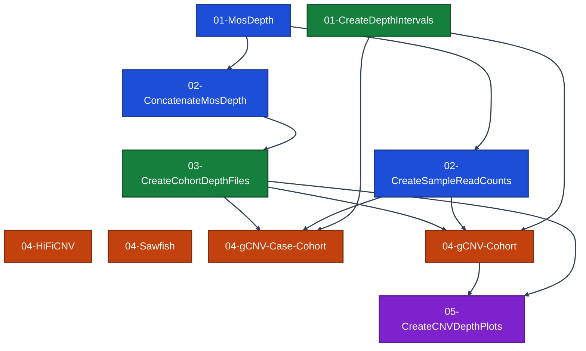

# CNV Pipeline
This document describes how to call depth-based CNVs on a new cohort, starting from aligned lrGS reads and finishing with a CNV VCF from each of three callers: GATK gCNV, run through `LongReadCNVs` in cohort or case-cohort mode, Sawfish and HiFiCNV. It is organized into four steps: computing each sample's depth, building the cohort depth files gCNV calls from, calling CNVs, and plotting the depth across gCNV calls for review. `MosDepth` and `ConcatenateMosDepth` are shared with the [Depth Summary](pipeline.md#depth-summary) of the main pipeline, so their outputs can be reused if they already exist.

Each workflow below is run on its own and passes its outputs to the next as inputs; on Terra, outputs are written to the data table and the next workflow's inputs point at those columns. Numbered lists are sequential; bulleted lists run in parallel. [Run Order](#run-order) flattens the pipeline into numbered steps, where every workflow sharing a number can run at the same time.

The graph below shows every workflow in run order, taken from the CNV template workspace's method configs and labelled with their [Run Order](#run-order) step numbers: an arrow means the second config reads a data table column or workspace attribute the first one writes. Workflows are coloured by the section that describes them: [per-sample depth](#1-per-sample-depth) blue, [cohort depth files](#2-cohort-depth-files) green and [CNV calling](#3-cnv-calling) orange and [CNV review](#4-cnv-review) purple. It is generated by [`generate_pipeline_dag.py`](../.github/scripts/generate_pipeline_dag.py) from [`method_configs_cnvs.json`](method_configs_cnvs.json), so edit those rather than the graph.

<!-- pipeline-dag:start -->

<!-- pipeline-dag:end -->

## Inputs
Everything below is cohort-specific and must be supplied per run. Reference files and Docker images are shared across cohorts and supplied separately - see [References](references.md) and [Docker images](dockers.md).
- **Aligned lrGS reads** - one aligned BAM and index per sample, plus the sample IDs, as produced by [MinimapReadAlignment](../wdl/tools/MinimapReadAlignment.wdl). On Terra these are the `sample` table's `aligned_bam`, `aligned_bai` and `sample_id` columns.
- **Sex** - `M` or `F` per sample, which selects the expected copy-number track for Sawfish and HiFiCNV. On Terra this is the `sample` table's `sex` column.
- **PED** - six-column pedigree covering every sample, providing sex (`1` male, `2` female) to gCNV's depth genotyping. Every sample is treated as unrelated, so the family and parent columns are not used. On Terra this is the `ped` workspace data.
- **Plot regions** - a BED of regions whose gCNV calls are plotted for review in step 4. On Terra this is the `sample_set` table's `cnv_plot_regions_bed` column; the template's holds the example cohort's truth deletions of at least 10 kb on the calling contigs.

A cohort without aligned reads first runs the two template-only `00` configs, which are left out of the graph and of [Run Order](#run-order):
- **[ResetAlignedReads](../wdl/tools/ResetAlignedReads.wdl)** (`00-ResetAlignedReads`) - turn an aligned BAM from elsewhere, the `sample` table's `full_depth_bam`, into an unaligned BAM downsampled to 30x, filling `unaligned_bam`, `full_depth_coverage` and `subsample_fraction`. Only needed when neither an aligned BAM from this pipeline nor an unaligned BAM is available.
- **[MinimapReadAlignment](../wdl/tools/MinimapReadAlignment.wdl)** (`00-MinimapReadAlignment`) - align the unaligned BAM to GRCh38, filling `aligned_bam` and `aligned_bai`. Runs after `00-ResetAlignedReads` when both are needed.

The template workspace, [LR_GNOMAD-AoU_TALK_CNV-Pipeline-Template](https://app.terra.bio/#workspaces/LR_GNOMAD_1_CO-AoU_TALK/LR_GNOMAD-AoU_TALK_CNV-Pipeline-Template), runs every step below on the same example cohort as the [main template](getting-started.md#template-workspace), starting from its aligned BAMs.

## Choices to Make
These settings shape the calls and have to be decided before the run. The template's choices are the ones the callers were benchmarked with.
- **Bin size** - gCNV calls over fixed-width read-count bins, and `CreateSampleReadCounts` and `CreateDepthIntervals` must use the same width. The template uses 2,000 bp. Long reads span several kilobases, so the depth of neighbouring bins is already strongly correlated at 2 kb and narrower bins add little independent signal, while the number of intervals, and with it the number of gCNV shards and the cost, grows in inverse proportion to the bin size. The callers were benchmarked on CNVs of at least 10 kb, five 2 kb bins. The separate `bin_size` of `CreateCohortDepthFiles` sets the resolution of the binned-coverage matrix that depth genotyping reads, and is left at its default of 100 bp.
- **Calling contigs** - `CreateDepthIntervals` lists the contigs gCNV calls on, and `LongReadCNVs` clusters and genotypes only those. Listing several contigs in one run fits each gCNV model across all of them. Set it to every contig, `chr1` to `chr22`, `chrX` and `chrY`, for a full callset; the template lists only `chr2`, `chr6` and `chr22` to keep the example small. Depth itself is always computed on all 24 contigs, since `CreateCohortDepthFiles` estimates ploidy against that exact karyotype. Sawfish and HiFiCNV take no contig list and always call the whole genome.
- **gCNV mode** - cohort mode fits the contig-ploidy and gCNV models on every sample and calls them all together; case-cohort mode fits them on a random subset of `num_training_samples` and then calls every sample against them, as GATK-SV does. Case-cohort mode keeps model fitting at a fixed size as the cohort grows, but fewer than a few dozen training samples degrades the fitted models. The template runs both, as `04-gCNV-Cohort` and `04-gCNV-Case-Cohort`; its case-cohort config trains on 2 of the 3 samples, which checks that the workflow runs but is far too few for usable models.
- **gCNV arguments** - the `gcnv_*` and `ploidy_*` inputs of both gCNV configs, and the `gcnv_case_*` and `ploidy_case_*` inputs of the case-cohort config, are the values GATK-SV's `TrainGCNV` and `GatherBatchEvidence` use, among them a CNV prior `gcnv_p_alt` of 1e-6, coherence lengths of 1,000 bp and no bias factors. The workflow defaults are gCNV's own, which converge poorly on uniform 30x long-read depth.
- **Excluded regions** - every caller drops regions in two stages. Reference assembly gaps, centromeres and telomeres, from GATK-SV's `hg38.wgs.blacklist.wPAR.bed`, are masked before calling. `LongReadCNVs` takes them as `blacklist_intervals` from `exclude_intervals_for_gcnv_filter_intervals_modified`, a copy restricted to the primary contigs, since GATK rejects intervals on contigs missing from the reference. Sawfish and HiFiCNV take them as `exclude_bed` from `exclude_intervals_for_gcnv_filter_intervals_bgz`, the full file bgzipped, which also covers every non-primary contig end to end and so keeps their depth calls off those contigs; Sawfish's calls from split and discordant reads are not masked, so its VCF still holds some records on non-primary contigs. Calls that a single region of the GATK-SV depth blacklist, the `depth_exclude_list` reference, covers by at least half are then dropped, through each caller's `exclude_intervals`; Sawfish applies this only to DEL and DUP records of at least 4 kb.
- **gCNV sharding** - gCNV is scattered over `num_intervals_per_scatter` intervals per shard, and each shard runs with 10 GiB of memory however many samples it holds. The template uses 5,000 intervals per shard, which a 292-sample cohort fits within; 10,000 ran out of memory at that size. The last shard of each scatter can hold up to twice the setting, so leave room.
- **Caller** - the three callers can run side by side. Benchmarked on 30x 1000 Genomes samples against short-read GATK-SV CNVs of at least 10 kb, Sawfish gave the most accurate DEL and DUP calls, gCNV missed few truth deletions but had low precision, and HiFiCNV missed most truth deletions.

## Run Order
Every workflow below, in dependency order. Workflows that share a step number need nothing from each other, so they can all be launched once the previous step finishes. On Terra the method configs are prefixed with these numbers. Per-sample workflows run once for each sample, and per-cohort workflows run once over the whole cohort. `LongReadCNVs` runs twice, once per gCNV mode, as `04-gCNV-Cohort` and `04-gCNV-Case-Cohort`. Sawfish and HiFiCNV read only the aligned reads, so they can also be launched at step 01. The [Optional Analyses](#optional-analyses) are left out.

| Step | Per sample | Per cohort |
| --- | --- | --- |
| 01 | MosDepth | CreateDepthIntervals |
| 02 | ConcatenateMosDepth, CreateSampleReadCounts | - |
| 03 | - | CreateCohortDepthFiles |
| 04 | HiFiCNV | Sawfish, gCNV-Cohort, gCNV-Case-Cohort |
| 05 | - | CreateCNVDepthPlots |

## 1. Per-Sample Depth
Each sample's per-base depth is computed once, then reshaped into the two forms gCNV needs: one combined BED for the cohort coverage matrix, and binned read counts.
1. **[MosDepth](../wdl/tools/MosDepth.wdl)** - compute per-base coverage per sample, once per contig, over all 24 contigs, with `stream_mode = true` so each contig is streamed straight from the BAM rather than split out first. Leave `bin_size` unset to keep per-base output.
2. Per-sample reshaping, in parallel on the per-contig BEDs:
   - **[ConcatenateMosDepth](../wdl/annotation_utils/ConcatenateMosDepth.wdl)** - concatenate the per-contig BEDs into one indexed per-base BED.
   - **[CreateSampleReadCounts](../wdl/annotation_utils/CreateSampleReadCounts.wdl)** - bin the per-contig BEDs at the bin size, 2,000 bp in the template, into a read-counts file, which is the sample's gCNV depth profile. Bin all 24 contigs; the calling contigs are chosen by the intervals in step 2.

Step 1 ends with a combined per-base BED and a binned read-counts file per sample.

## 2. Cohort Depth Files
Independent of each other; `CreateDepthIntervals` needs only the reference index, so it runs at step 01 alongside MosDepth:
- **[CreateDepthIntervals](../wdl/annotation_utils/CreateDepthIntervals.wdl)** - write the interval list gCNV calls over, matching the read-count bins, from the reference index, the calling contigs and the bin size.
- **[CreateCohortDepthFiles](../wdl/annotation_utils/CreateCohortDepthFiles.wdl)** - build the cohort binned-coverage matrix, per-sample median coverage and ploidy estimates from the combined per-base BEDs. Check the ploidy plots and `estimated_cn` against each sample's recorded sex before calling.

Step 2 ends with the interval list, the binned-coverage matrix and the median coverage table.

## 3. CNV Calling
The three callers run in parallel and independently, each producing its own VCF.
- **[LongReadCNVs](../wdl/tools/LongReadCNVs.wdl)** - call CNVs with GATK gCNV over the intervals from the read-count files, then merge, cluster and genotype them against the binned-coverage matrix and median coverage. Set `sort_depth_profiles = true`, pass the PED as `pedigree` and all 24 contigs as `contigs`, and set the excluded regions, mode, gCNV arguments and sharding as in [Choices to Make](#choices-to-make). Run in one of two modes:
  - **Cohort mode** (`04-gCNV-Cohort`) - leave `num_training_samples` at `-1`, so every sample is used to fit the contig-ploidy and gCNV models.
  - **Case-cohort mode** (`04-gCNV-Case-Cohort`) - set `num_training_samples` below the cohort size, e.g. 100. The case-mode calls take their own `ploidy_case_*` and `gcnv_case_*` settings, each falling back to the matching cohort-mode input when unset.

  Its outputs are the merged per-sample gCNV calls in `merged_cnvs_vcf`, the per-sample ploidy table, and the genotyped cohort CNV VCF in `genotyped_depth_vcf` with its read-depth table. The template writes each mode's outputs to columns prefixed `gcnv_cohort_` and `gcnv_case_cohort_`.
- **[Sawfish](../wdl/tools/Sawfish.wdl)** - discover SVs and depth changes per sample, then joint-call the cohort into one VCF of every SV type, whose DEL and DUP records are the CNV calls. The discover and joint-call steps need more memory than the defaults: the template sets 40 GiB and 25 GiB.
- **[HiFiCNV](../wdl/tools/HiFiCNV.wdl)** - call CNVs from each sample's depth, one VCF per sample.

Step 3 ends with a genotyped cohort CNV VCF from gCNV in each mode, a joint Sawfish VCF and a HiFiCNV VCF per sample.

## 4. CNV Review
Optional, but the quickest check that gCNV's calls are real:
- **[CreateCNVDepthPlots](../wdl/annotation_utils/CreateCNVDepthPlots.wdl)** - draw read-depth plots for the CNVs of a gCNV `genotyped_depth_vcf` that fall within a BED of regions, one plot per non-reference sample per CNV, with a padded window around each call, for review by eye. Pass the same `merged_bincov` and `median_coverage` given to `LongReadCNVs`, and the `repeat_masked_bed`, `seg_dup_bed` and `simple_repeats_bed` references, which label each CNV's genomic context. The plots come back as one tarball with a folder per variant ID and one PNG per non-reference sample, named `<sample>.<context>.png` by the CNV's genomic context, alongside a table of the selected CNVs. The template plots the cohort-mode calls within the [plot regions](#inputs).

Step 4 ends with a tarball of depth plots and a table of the plotted CNVs.

## Optional Analyses
These workflows are not needed to produce the CNV VCFs. On Terra their method configs carry no step number.
- **[Automop](../wdl/tools/Automop.wdl)** - delete the workspace's intermediate files that no data table references. It only lists them while `dry_run` is `true`.
